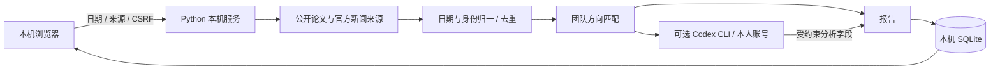

# 架构说明

## 运行边界

Python 标准库 HTTP 服务仅绑定 `127.0.0.1`，静态 HTML/CSS/JavaScript 提供本地页面，SQLite 保存报告、设置、缓存和会议论文集观察基线。源码不依赖云端站点部署或第三方 Python 包。

浏览器获取启动信息和 CSRF 令牌，提交日期窗口与分析选项，后台生成唯一任务并提供轮询进度。抓取器从公开来源获取候选内容，统一日期依据、来源与状态，合并同一论文的多源记录。规则匹配提供可解释的候选排序；可选的 Codex 子进程使用成员自己的 CLI 登录状态分析公开候选。模型只能填写受约束的分析字段；来源事实和链接来自抓取结果。完成报告写入 SQLite，可在历史记录查看和导出。

抓取公开来源需要互联网；Codex CLI 通过成员自己的登录调用云端模型。默认周窗口按上海时区从周一到今天，今天的数据仍在陆续发布。候选先按规则召回，再按五个方向留出多样性名额进入 Codex 的分析清单，每次最多 24 条，兼顾论文与新闻；其余候选仍以规则初筛呈现。新闻按产业意义独立排序。每条重点论文应说明与具体方向及已有背景工作的关系，并提出下一步阅读或小实验。

## 数据流

## 事实与判断

标题、作者、公开链接、原始日期、推荐日、更新日、公开投稿状态和来源健康属于可回溯事实。方向归属、分数、价值解释、团队关联和行动建议属于模型或规则推断。报告同时显示分析模式和时间依据。历史成果用于画像，不能自动当成当前周的新论文；公开投稿不能自动当成录用论文；首次观察到论文集链接不能自动当成正式发布日期。

## 防护与可扩展性

本地接口校验 Host、Origin、CSRF 及请求格式；静态文件路径受项目静态目录约束。补充订阅只允许公开 HTTPS 地址并限制对本地与私有网络的访问。模型输出经结构和候选身份校验，外部文本按不可信数据处理。失败来源、无结果来源和关闭来源分别展示。

未来如需多人共享服务，应重新设计登录、角色权限、部署、凭据隔离与网络访问策略。当前版本按每人本机运行设计。

## 按需全文核对与持久追踪

`analysis.py` 独立于周报摘要流程：从论文公开 HTML 或可选 PDF 提取正文，拒绝摘要页，按正文块验证模型给出的摘录与位置。模型输出经过字段、类型、已提供基准来源与摘录校验；正文不可得时不启动模型并返回 `insufficient`。全文取得时间、来源、指纹与版本局限和分析一起保存；旧报告按需增加 `research_analysis`，不存在该字段时保留原展示及导出。

`tracking.py` 将用户启用的论文快照、确认的仓库和历史存于 SQLite，按 arXiv canonical ID 跨周合并。论文页面发现的 GitHub URL 只作为候选，不自动赋予关联或已开源结论。每个资源以首次成功观察为基线，后续比较论文版本/投稿状态、已确认仓库提交/release 和资源状态/目标地址；失败保留此前事实。仓库配置修改会重建对应基线。手动检查、周报后检查和服务存活期间的约 24 小时检查共用同一逻辑，不依赖云端定时任务。

公开资源只允许无凭据的 HTTPS 与默认端口，并在重定向时重新校验。为兼容本机代理的 fake-IP DNS，仅精确列举的内置官方域名可使用 `198.18.0.0/15`；自定义域名、相似域名和任意 RFC1918/loopback/链路本地地址继续拒绝。TLS 证书验证保持启用。
